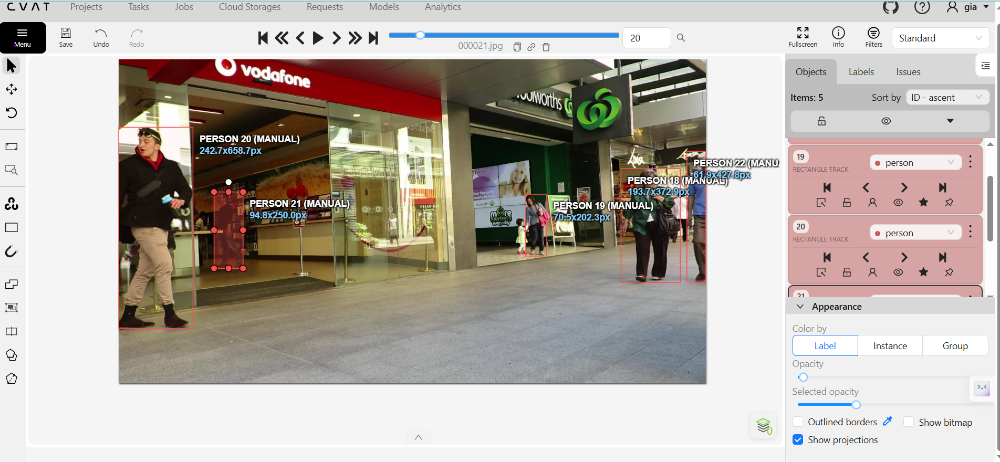
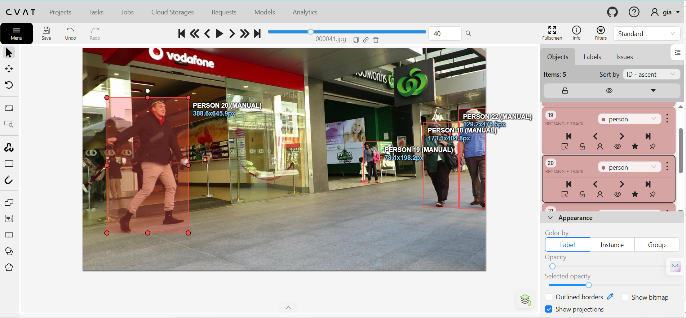
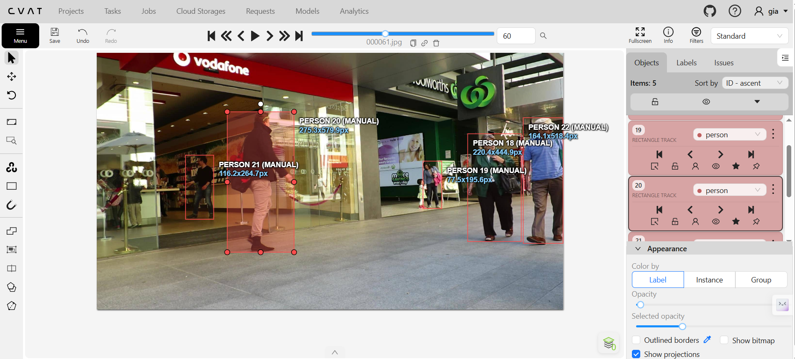

# Báo cáo cá nhân — DangHoangGia-03065

Đoạn video: MOT17-09, 150 frame (frame 1–150), nguồn MOTChallenge, giấy phép CC BY-NC-SA 3.0.

## 0. Thông tin học viên

- Họ tên: Đặng Hoàng Gia
- MSSV: 03065
- Mã đề (A/B/C): B
- Email: danggia2412@gmail.com
- Link repository: `https://github.com/dieu-cay-15/K5-L2-DAY05-DANGHOANGGIA-03065-MOTTracking`
- Giờ bắt đầu: 16:30
- Giờ kết thúc: 20:30

## 1. Xem trước đoạn video (CP0)

Ghi **trước khi vẽ**, mỗi người một dòng.

| Mã | Frame xuất hiện | Frame cuối thấy được | Rẽ / dừng / đổi tốc độ ở frame | Bị che ở frame | Ghi chú |
|---|---:|---:|---|---|---|
| P1 | 0 | 149 | Đi chậm dần trong shop Vodafone quanh frame 25–60 | 30–39 (một phần), 40–49 (khuất hẳn), 50–59 (một phần) | Nam áo len đen bên trong cửa hàng Vodafone |
| P2 | 0 | 149 | Tiến lại gần camera, kích thước box tăng dần từ frame 20–149 | Không bị che | Nữ áo khoác xanh lá đeo túi đen bên phải |
| P3 | 0 | 149 | Đi thẳng tiến lại gần camera từ mép phải | Không bị che | Nam áo xanh dương đội mũ bên phải |
| P4 | 0 | 149 | Chuyển động nhanh ngang khung hình từ trái sang phải | Không bị che | Nam áo khoác đen quần kaki |
| P5 | 0 | 108 | Rẽ vào cửa hàng Woolworths ở đoạn cuối (frame 80–108) | 90–108 (bị che một phần khi vào cửa), mất hẳn từ frame 109 | Nữ áo tối màu đeo túi hồng |

## 2. Keyframe và thời gian (CP1, CP4)

Số keyframe lấy từ kết quả `src/check_submission.py`.

| Mã | Số keyframe | Keyframe ở frame | Số frame có mặt | Keyframe / 100 frame | Thời gian (phút) | Chỗ khó |
|---|---:|---|---:|---:|---:|---|
| P1 (CVAT Track 3 / MOT ID 4) | 15 | 0, 10, 20, 30, 50, 60, 70, 80, 90, 100, 110, 120, 130, 140, 149 | 140 | 10.7 | ~25 | Bị che khuất qua cửa kính bởi người đi ngang qua (frame 30–59), phải ước lượng amodal box và bật tắt `occluded`/`outside` đúng mốc |
| P2 (CVAT Track 0 / MOT ID 1) | 16 | 0, 10, 20, 30, 40, 50, 60, 70, 80, 90, 100, 110, 120, 130, 140, 149 | 150 | 10.7 | ~15 | Người tiến lại gần camera nên kích thước box thay đổi liên tục |
| P3 (CVAT Track 4 / MOT ID 5) | 16 | 0, 10, 20, 30, 40, 50, 60, 70, 80, 90, 100, 110, 120, 130, 140, 149 | 150 | 10.7 | ~15 | Ở mép phải khung hình ở các frame đầu, cần bám sát rìa ảnh |
| P4 (CVAT Track 2 / MOT ID 3) | 16 | 0, 10, 20, 30, 40, 50, 60, 70, 80, 90, 100, 110, 120, 130, 140, 149 | 150 | 10.7 | ~15 | Chuyển động nhanh ngang khung hình từ trái sang phải |
| P5 (CVAT Track 1 / MOT ID 2) | 7 | 0, 20, 40, 60, 80, 90, 100 | 109 | 6.4 | ~15 | Đi vào vùng tối trong cửa hàng Woolworths, bật `occluded` từ 90–108 và `outside` từ 109 |
| **Tổng** | **70** | — | **699** | **10.0** | **~85** | |

Keyframe / 100 frame của cả bài = tổng keyframe ÷ tổng số frame có mặt × 100 = 70 ÷ 699 × 100 = **10.0** keyframe / 100 frame.

Bạn đặt keyframe nhiều nhất ở người nào? Vì sao (người đó rẽ, dừng, lại gần camera hay bị che)?

Đặt keyframe đều ở mức 15–16 keyframe cho các track xuất hiện đủ 150 frame (P1, P2, P3 và P4), mật độ ~10.7 keyframe / 100 frame. Riêng P1 tuy chỉ có mặt 140 frame (do `outside` 10 frame) nhưng có 15 keyframe vì phải đánh dấu thêm mốc trước khi bị che (frame 30) và ngay khi hiện lại (frame 50); các người đi lại gần camera (P2, P3) cần keyframe định kỳ mỗi 10 frame để kích thước box không bị trôi.

## 3. Đoạn bị che (CP2)

Người bị che: `P1` (CVAT Track ID 3 / MOT Track ID 4)

| Mốc | Frame |
|---|---:|
| Bắt đầu bị che một phần (bật `occluded`) | 30 |
| Mất hẳn (bật `outside`) | 40 |
| Hiện lại (tắt `outside`) | 50 |
| Thấy rõ trở lại (tắt `occluded`) | 60 |

- Thời gian khuất hẳn: `10` frame (frame 40–49) = `0.33` giây (ở 30 fps).
- Quyết định: **giữ cùng ID**.
- Lý do (trả lời 3 câu: khuất bao lâu so với 60 frame, ngoại hình có khớp, chỗ hiện lại có đúng hướng và tốc độ):
  1. Thời gian khuất hẳn là 10 frame (~0.33 giây), nhỏ hơn rất nhiều so với ngưỡng 60 frame (2 giây) của lớp.
  2. Ngoại hình khớp hoàn toàn: vẫn là người đàn ông mặc áo len đen, quần tối màu ở bên trong cửa hàng Vodafone.
  3. Vị trí hiện lại (frame 50) nằm đúng trên quỹ đạo di chuyển và vận tốc trước khi bị che (tiếp tục đi chậm sang phải phía sau cửa kính).

Ảnh chụp màn hình (nguồn: MOT17, MOTChallenge, Milan et al., 2016):





## 4. Tự review ID (CP3)

Lượt 1 theo người (đi ngược từ frame 149 về 0 trên CVAT), lượt 2 theo cảnh (nhảy 10 frame). Ít nhất 3 dòng; không có lỗi thì ghi một dòng "đã kiểm hai lượt, không lỗi".

Loại lỗi dùng đúng một trong 7 mã: `id_switch`, `fragmentation`, `lost`, `merge`, `false_track`, `drift`, `flag`.

| Frame | Mã người | Loại lỗi | Mô tả một câu | Phát hiện ở lượt | Đã sửa? |
|---:|---|---|---|---|---|
| 35 | P1 | `flag` | Thiếu cờ `occluded` khi người đi ngang qua bắt đầu che một phần P1, đã bật `occluded` từ frame 30–39 và 50–59 | Lượt 1 | Có |
| 40–49 | P1 | `lost` | Cần bật `outside` trong đoạn bị che hoàn toàn thay vì để box trôi phía sau người che | Lượt 1 | Có |
| 95 | P5 | `drift` | Box hơi lệch khi P5 rẽ vào cửa hàng Woolworths, đã chỉnh lại keyframe tại frame 90 và 100 | Lượt 2 | Có |

Tổng hợp số lỗi theo loại:

| `id_switch` | `fragmentation` | `lost` | `merge` | `false_track` | `drift` | `flag` |
|---:|---:|---:|---:|---:|---:|---:|
| 0 | 0 | 1 | 0 | 0 | 1 | 1 |

Lỗi nào chỉ lượt 2 (theo cảnh) mới thấy, lượt 1 (theo người) không thấy? Vì sao?

Các lỗi tương quan giữa nhiều người trên cùng một khung hình (như `id_switch` giữa hai người đi cắt nhau, `merge` hai người vào một box, hoặc `false_track`/nhầm đối tượng trên toàn cảnh) dễ phát hiện hơn ở lượt 2 (xem toàn cảnh cả 5 box cùng lúc) so với lượt 1 (chỉ tập trung nhìn một người đơn lẻ).

## 5. File xuất và kết quả tự kiểm (CP4)

| Kiểm tra | Kết quả |
|---|---|
| Tên file MOT 1.1 | `src/exports/DangHoangGia_mot.zip` |
| Tên file CVAT for video 1.1 | `src/exports/DangHoangGia_cvat_video.zip` |
| Số track ID khác nhau trong `gt/gt.txt` (phải là 5) | `5` |
| Frame `outside` không có dòng trong `gt.txt` (đúng / sai) | Đúng (kiểm tra Track 4 / P1 không có dòng cho frame CVAT 40–49, tức `frame_id` 41–50 trong `gt.txt`) |
| Job đã completed trên CVAT máy cá nhân | Đã hoàn thành |

Dán phần tóm tắt in ra từ `src/check_submission.py`:

```text
Số frame in theo CVAT (bắt đầu từ 0). Trong gt.txt, frame_id = frame CVAT + 1.

=== File MOT 1.1: DangHoangGia_mot.zip ===
  Số track ID: 5   |   Tổng số box: 699
  [OK]        Đúng 5 track ID.

  Track | Frame có mặt | Số frame | Đoạn vắng (outside)
      1 |   0–149      |      150 | -
      2 |   0–108      |      109 | -
      3 |   0–149      |      150 | -
      4 |   0–149      |      140 | 40–49
      5 |   0–149      |      150 | -


=== File CVAT for video 1.1: DangHoangGia_cvat_video.zip ===

  Track | Nhãn   | Frame thấy | Keyframe | KF/100 frame | Frame occluded | Lần bật outside
      0 | person |        150 |       16 |         10.7 |              0 |               0
      1 | person |        109 |        7 |          6.4 |             19 |               1
      2 | person |        150 |       16 |         10.7 |              0 |               0
      3 | person |        140 |       15 |         10.7 |             20 |               1
      4 | person |        150 |       16 |         10.7 |              0 |               0

  Tổng: 70 keyframe / 699 frame có mặt = 10.0 keyframe / 100 frame
  [OK]        Đọc được 5 track từ annotations.xml.

=== Tóm tắt ===
  Lỗi: 0   |   Cảnh báo: 0
  Đạt. Dán phần tóm tắt này vào báo cáo mục 5.
```

## 6. Ba câu kết

1. Nếu được gán lại, bạn sẽ đặt keyframe khác ở đâu? Vì sao?

   Ở những đoạn người đi thẳng đều (như P2, P3 giữa đoạn), có thể giãn keyframe thưa hơn (15–20 frame thay vì 10 frame) và dồn keyframe dày hơn ở các đoạn đổi hướng hoặc thay đổi kích thước nhanh khi lại gần camera.

2. Có chỗ nào bạn không chắc "cùng ID hay ID mới"? Bạn đã quyết định và ghi chú thế nào?

   Chỗ P1 bị che khuất bởi người đi ngang qua ở frame 40–49. Vì thời gian khuất hẳn chỉ 10 frame (~0.33 giây, nhỏ hơn nhiều so với ngưỡng 60 frame) và ngoại hình, hướng di chuyển sau khi hiện lại khớp hoàn toàn nên quyết định giữ cùng ID và ghi chú 4 mốc che khuất vào mục 3.

3. Một lỗi ID trong job của bạn (nếu không còn sót, chọn lỗi đã sửa) có thể làm xe tự lái dự đoán sai chuyển động của người đó như thế nào? Lỗi đó ảnh hưởng MOTA hay IDF1 nhiều hơn?

   Nếu xảy ra `id_switch` (ví dụ P1 bị đổi sang ID của người che đi ngang qua), bộ ước lượng vận tốc của xe tự lái sẽ tính sai vector chuyển động đột ngột (nhảy từ trong cửa hàng ra giữa lối đi chỉ trong 1/30 giây), dẫn đến dự đoán quỹ đạo va chạm sai. Lỗi `id_switch` ảnh hưởng tới **IDF1** nhiều hơn đáng kể so với MOTA, vì MOTA chỉ cộng thêm 1 lỗi cho mỗi lần chuyển ID còn IDF1 phạt toàn bộ đoạn track bị gán sai ID sau thời điểm chuyển.

## 7. Tài liệu tham khảo và công cụ AI đã dùng

- Tài liệu hướng dẫn của môn học: `README.md`, `CHECKPOINTS.md`, `docs/GUIDELINE.md`, `docs/MOT_FORMAT.md`, `SUBMISSION.md`.
- MOT17, MOTChallenge (Milan et al., 2016).
- Công cụ CVAT Community (local) và script kiểm tra `src/check_submission.py`.
